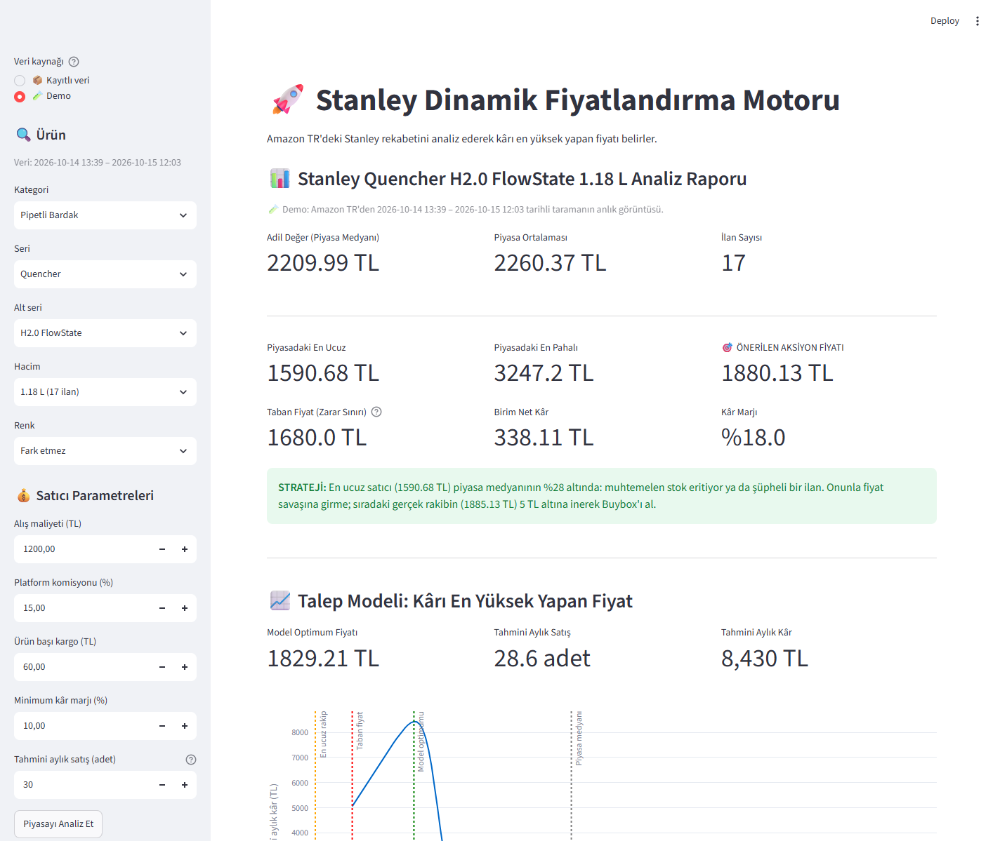
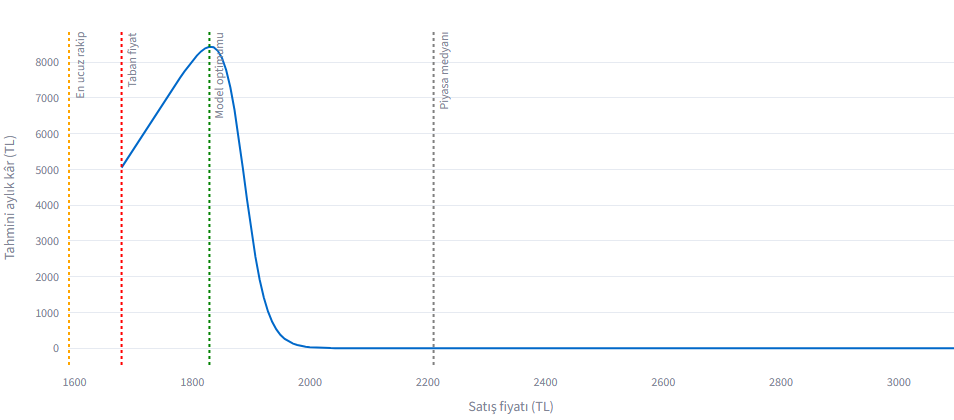
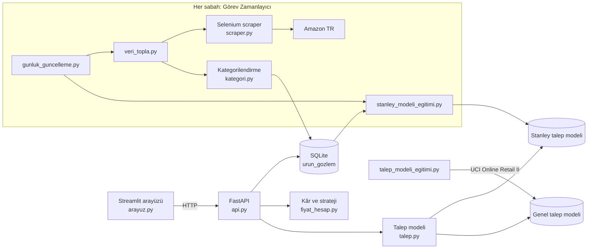

# Stanley Pazar Analizi ve Kâr Optimizasyonu (Amazon TR)

[](https://github.com/iefekarakulak/stanley-dinamik-fiyatlandirma/actions/workflows/testler.yml)

Amazon TR'de Stanley ürünleri satmayı düşünen bir satıcı için **"Bu ürünü bu maliyetle satarsam hangi fiyattan en çok kârı ederim, rekabet edebilir miyim?"** sorusunu cevaplayan uçtan uca bir sistem: günlük veri toplama, kategorilendirme, talep modeli ve kâr optimizasyonu.



- **Günlük veri toplama:** Amazon TR'deki tüm Stanley ilanları her sabah otomatik toplanır; veri seti her gün büyür
- **Kategorilendirme:** İlan başlıklarından ürün tipi, seri, alt seri ve hacim; aksesuarlar ve aynı adlı alet markası (Stanley Tools) ayrılır
- **Kâr sınırlı strateji:** Maliyet, komisyon, kargo ve minimum marja göre taban fiyat; sistem zarar ettiren fiyatı asla önermez
- **Talep modeli:** Fiyat değişince satışın nasıl değiştiğini tahmin eden gradient boosting modeli; yeterli veri birikince Stanley'nin kendi pazar verisiyle her gün yeniden eğitilir
- **Kâr eğrisi:** Her aday fiyat için *tahmini satış × birim kâr*; en kârlı fiyat



*Kâr eğrisi: taban fiyatın altında öneri yapılmaz; rakibin üstüne çıkıldıkça Buybox kaybedildiği için tahmini kâr hızla düşer.*

## Amazon'un kendi fiyatlandırma aracından farkı

Amazon, satıcılara Seller Central'da kural tabanlı otomatik fiyatlandırma (Automate Pricing) sunar: "Buybox fiyatını eşitle ya da X TL altına in, şu minimumun altına düşme". Bu proje bir yeniden fiyatlandırma (repricer) aracı değil, farklı bir soruyu cevaplar:

| | Amazon Automate Pricing | Bu proje |
|---|---|---|
| Ne zaman kullanılır | Satıcı olduktan sonra, kendi ilanları için | **Satmaya karar vermeden önce**, satıcı hesabı gerekmeden |
| Hedef | Rakibe göre konumlanmak | **Toplam kârı** en yükseğe çıkarmak (talep × birim kâr) |
| Rakibin altına inmek | Kural öyle diyorsa her zaman | Kâr düşüyorsa inmez; zarar sınırının altına asla inmez |
| Pazar görünümü | Kendi ürünü | Tüm Stanley kataloğu: kategori, seri, satış rozeti, indirim, stok |

## Mimari



```
├── arayuz.py                   # Streamlit arayüzü: ürün ve satıcı parametreleri, metrikler, kâr eğrisi
├── api.py                      # FastAPI servisi: kayıtlı ilanlar → piyasa özeti → strateji → talep modeli
├── fiyat_hesap.py              # Piyasa özeti, birim kâr, taban fiyat, kural tabanlı strateji
├── talep.py                    # Talep çarpanı (aktif model seçimi), Buybox payı, kâr eğrisi optimizasyonu
├── kategori.py                 # Başlıktan kategori/seri/alt seri/hacim/renk okuma
├── database.py                 # SQLite: günlük ilan gözlemleri, demo verisi
├── scraper.py                  # Amazon TR taraması (Selenium), bot engeli tespiti
├── veri_topla.py               # Marka filtreli tüm Stanley ilanlarının toplanması
├── gunluk_guncelleme.py        # Günlük döngü: topla → kategorile → modeli yeniden eğit
├── gunluk_calistir.bat         # Görev Zamanlayıcı'nın çalıştırdığı dosya
├── stanley_modeli_egitimi.py   # Stanley'ye özel talep modeli (günlük veriyle)
├── talep_modeli_egitimi.py     # Genel talep modeli (UCI Online Retail II)
├── model/                      # Eğitilmiş genel model ve metrikleri
├── ornek_veri/                 # Demo modu: gerçek bir taramanın anlık görüntüsü
├── tests/                      # pytest testleri
└── veri/                       # Ham eğitim verisi (depoda yok, README'deki adımla indirilir)
```

## Veri kaynakları

Arayüz Amazon'a istek atmaz; veri, her sabah çalışan günlük güncellemeyle toplanır. Veri toplama ile analizin ayrılması sayesinde Amazon'a günde yalnızca bir tur istek gider ve arayüzde yapılan analiz sayısı bot engeli riskini artırmaz.

| Kaynak | Nasıl çalışır |
|---|---|
| **📦 Kayıtlı veri** (varsayılan) | Son 7 günün ilanları. Ürün **kategori → seri → alt seri → hacim** olarak seçilir; her ilanın en güncel fiyatı kullanılır, aksesuarlar hariç tutulur. |
| **🧪 Demo** | `ornek_veri/stanley_ornek.json`: gerçek bir taramanın anlık görüntüsü (285 ilan). Veritabanı ve Amazon erişimi olmadan tüm uygulama denenebilir. |

## Fiyatlandırma mantığı

**Taban fiyat** (minimum marjı sağlayan en düşük fiyat):

```
birim_net_kâr = fiyat × (1 − komisyon) − alış_maliyeti − kargo
taban_fiyat   = (alış_maliyeti + kargo) / (1 − komisyon − min_marj)
```

**Kural tabanlı öneri:** Buybox rakibinin 5 TL altına inilir. Buybox rakibi en ucuz ilandır; ancak piyasa medyanının %85'inin altındaki ilanlar (stok eritme / şüpheli ilan) yok sayılır ve sıradaki gerçek rakip alınır. Talep modeli de aynı rakibi referans alır. Her durumda sonuç taban fiyatın altına düşmez.

> İlk sürümde aykırı ucuz bir rakip varken kural "medyanın %5 altına" konumlanıyordu. Bu, aradaki gerçek rakipleri atlıyordu: demo verisinde kural 2.099 TL önerirken 1.885 TL'de satan bir rakip vardı ve talep modeli 1.829 TL'yi optimum buluyordu. Kural, modelle aynı rakibi referans alacak şekilde düzeltildi; şimdi 1.880 TL öneriyor.

**Model tabanlı optimum:**

```
tahmini_satış(fiyat) = aylık_satış × kategori_talep_çarpanı(fiyat / medyan) × buybox_payı(fiyat, rakip)
aylık_kâr(fiyat)     = tahmini_satış(fiyat) × birim_net_kâr(fiyat)
```

Taban fiyattan medyanın %40 üstüne kadar 200 fiyat denenir, aylık kârı en yüksek olan seçilir.

- **Kategori talep çarpanı veriden öğrenilir** (aşağıdaki model).
- **Buybox payı bir varsayımdır:** Rakiple aynı fiyatta %50, ~%2 altında ~%90, ~%2 üstünde ~%10 (lojistik eğri, `talep.BUYBOX_GENISLIK`). Eğitim verisindeki satıcının aynı ürünü satan rakibi olmadığından bu etki o veriden öğrenilemez. İlk denemede bu bileşen yoktu ve model fiyatı piyasanın %40 üstüne çıkarmayı öneriyordu. Rekabet etkisi talep modeline eklenmeden optimizasyon anlamsız sonuç veriyor.

## Talep modeli

**Veri:** [UCI Online Retail II](https://archive.ics.uci.edu/dataset/502/online+retail+ii) – İngiltere merkezli bir online perakendecinin 2009–2011 satışları, 1.067.371 satır (CC BY 4.0).

**Hazırlık:**
1. İadeler, sıfır/negatif adet ve ürün olmayan kodlar (posta, banka ücreti vb.) çıkarıldı
2. Satırlar ürün-hafta bazında toplandı; 20 haftadan az satışı olan ürünler çıkarıldı (2.950 ürün kaldı)
3. `fiyat_oranı = haftalık liste fiyatı / ürünün normal fiyatı`; normal fiyat ve normal talep **sadece eğitim döneminden** hesaplandı (veri sızıntısını önlemek için)

**Ters nedensellik düzeltmesi:** Bu satıcı toptan alana birim fiyatı düşürüyor. Haftalık fiyat tüm siparişlerden alındığında model "çok alındığı için fiyat düşük" ilişkisini "fiyat düşük olduğu için çok alındı" diye öğrendi ve esnekliği **−6,5** gibi gerçek dışı bir değer olarak tahmin etti. Liste fiyatı yalnızca küçük siparişlerden (≤6 adet) alınınca esneklik makul aralığa indi.

**Model:** `HistGradientBoostingRegressor`, hedef `log(1 + haftalık adet)`. Özellikler: log fiyat oranı, ürünün normal talebi, son 4 haftanın talebi, ay. Fiyat oranına **monoton azalan kısıt** uygulandı (fiyat artınca tahmini talep artamaz).

**Değerlendirme:** Zamana göre ayrılmış test seti (Temmuz 2011 sonrası, 33.315 ürün-hafta). Karşılaştırma tahmini: "her hafta normal talebi kadar satar".

| | Model | Karşılaştırma tahmini | İyileşme |
|---|---|---|---|
| MAE (log adet), tüm haftalar | 0,726 | 0,822 | %12 |
| MAE (log adet), fiyatı değişen haftalar | 0,761 | 0,923 | %18 |
| Ortalama fiyat esnekliği | −1,41 | | |

Modelin asıl katkısı, tam da fiyatlandırma kararının önemli olduğu **fiyatı değişen haftalarda** ortaya çıkıyor.

## Günlük öğrenme döngüsü

Proje hazır bir veri setiyle başlamadı; Stanley pazarına ait veri seti her gün büyür:

```
Her gün (Görev Zamanlayıcı → gunluk_calistir.bat → gunluk_guncelleme.py)
  1. veri_topla.py               Amazon TR'deki Stanley ilanları → urun_gozlem tablosuna eklenir
  2. stanley_modeli_egitimi.py   Birikmiş tüm günlerle Stanley talep modeli yeniden eğitilir
  3. API                         Yeni model, yeniden başlatmaya gerek kalmadan kullanılır
```

**Stanley talep modeli** (`stanley_modeli_egitimi.py`): Aynı gün aynı ürün grubundaki (seri + alt seri + hacim) ilanlar karşılaştırılır. Hedef "Geçen ay X adetten fazla satın alındı" rozetinden aylık satış tahmini, ana özellik `log(fiyat / grup medyanı)`. Yorum sayısı, puan, indirim oranı ve sponsorlu bilgisi kontrol özelliği olarak kullanılır (çok yorumlu bir ilan hem pahalı hem çok satan olabilir).

**Devreye alma kuralları:** Model şu koşullar sağlanmadan kullanılmaz; o zamana kadar UCI modeli devam eder:
- En az 14 günlük ve 500 ilan-gün kaydı
- Son günlerden oluşan test setinde, fiyat bilgisi **olmayan** aynı modele göre hatayı en az %3 azaltmak (yani fiyat gerçekten tahmine katkı yapmalı)
- Negatif fiyat esnekliği

Bu kurallar sentetik veriyle test edildi: fiyatın satışı etkilediği veride model devreye giriyor ve esnekliği yakalıyor; fiyatın etkisiz olduğu veride devreye girmiyor.

Durum her eğitimden sonra `model/stanley_talep_modeli_metrikler.json` dosyasına, günlük çıktılar `logs/gunluk_guncelleme.log` dosyasına yazılır. Arayüzdeki kâr eğrisi altında hangi modelin kullanıldığı gösterilir.

## Kurulum ve çalıştırma

```bash
pip install -r requirements.txt

# (İsteğe bağlı) Talep modelini yeniden eğitmek: eğitilmiş model (model/talep_modeli.joblib) depoda hazır.
# Yeniden eğitmek için UCI'den online+retail+ii.zip'i indirip online_retail_II.xlsx'i veri/ klasörüne çıkarın
python talep_modeli_egitimi.py

# Amazon TR'den güncel Stanley ilanlarını topla (günde en fazla 1 kez)
python veri_topla.py

# 1. terminal: API
python -m uvicorn api:app --reload

# 2. terminal: arayüz
python -m streamlit run arayuz.py

# Testler
python -m pytest tests
```

Selenium için Chrome kurulu olmalıdır. Veri toplamadan denemek için arayüzde **🧪 Demo** kaynağını seçin.

**Günlük otomatik güncelleme (Windows):** Görev Zamanlayıcı'da `gunluk_calistir.bat` dosyasını her gün çalıştıran bir görev oluşturun ("kaçırılırsa ilk fırsatta çalıştır" seçeneği açık).

## Veri toplama

`veri_topla.py`, Amazon TR'de marka filtresiyle "stanley" araması yapar ve sonuçlar bitene kadar (en fazla 7 sayfa) tüm Stanley ilanlarını `urun_gozlem` tablosuna kaydeder: fiyat, hacim, "Geçen ay X adetten fazla satın alındı" rozeti, yorum sayısı, puan, üstü çizili önceki fiyat (indirim oranı), "Stokta sadece X adet kaldı" uyarısı ve sponsorlu olup olmadığı. Günde en fazla 1 kez çalışacak şekilde tasarlandı. Sayfalar arasında bekleme süresi var ve bot engeli algılanınca tarama durduruluyor.

**Kategorilendirme (`kategori.py`):** Her ilan başlığından kural tabanlı olarak çıkarılır. Kurallar gerçek Amazon TR başlıklarından türetildi ve testlerle sabitlendi.

| Alan | Örnek değerler |
|---|---|
| Kategori | Termos, Pipetli Bardak, Kupa & Bardak, Yemek Termosu, Su Şişesi, Cep Matarası, Soğutucu & Sürahi, Kahve Ekipmanı, Saklama Kabı |
| Seri | Classic Legendary, Quencher, Adventure, IceFlow, Aerolight, Transit, Everyday, Stay Hot, Wellspring... |
| Alt seri (Quencher) | H2.0 FlowState, ProTour, Fluted (başlıkta yoksa Stanley ürün kodundan) |

Fiyat analizine **katılmayanlar**:
- **Aksesuarlar** (kapak seti, yedek pipet, kılıf...) ve başka firmaların "Stanley ile uyumlu" ürünleri: aksi halde 130–550 TL'lik bir kapak, 2.000 TL'lik termosun piyasa fiyatını aşağı çeker.
- **Stanley Tools** ürünleri (zımpara, maket bıçağı, matkap ucu...): aynı adı taşıyan alet markası. Amazon'un marka filtresi ikisini ayırmıyor.

Kategori başlıktan türetilen bir alan olduğu için kurallar geliştiğinde günlük güncelleme tüm geçmiş kayıtları yeniden kategoriler.

## Sınırlamalar

- **Stanley modeli devreye girene kadar talep modeli termos pazarına özel değil.** O zamana kadar İngiltere'deki hediyelik eşya satışlarından öğrenilen genel fiyat-talep ilişkisi kullanılır.
- **Satış verisi kaba.** Amazon satış adedini paylaşmaz; "Geçen ay X adetten fazla satın alındı" rozeti yalnızca belirli bir eşiğin üstünde ve kaba aralıklarla gösterilir.
- **Buybox payı varsayım.** Gerçek Buybox algoritması fiyatın yanında satıcı puanı, teslimat süresi ve stok durumunu da dikkate alır.
- **Satıcı değil ilan sayılıyor.** Arama sonuçlarında aynı ürünü satan diğer satıcılar görünmez, sadece Buybox kazananın fiyatı görünür.
- **Amazon bot koruması.** Sık tarama geçici engellemeye yol açar; bu yüzden veri günde bir kez toplanır ve arayüz Amazon'a istek atmaz. Otomatik veri toplama Amazon'un kullanım koşullarıyla sınırlıdır; bu proje eğitim amaçlıdır ve düşük sıklıkta çalışır.

## Geliştirme fikirleri

- Ürün bazında fiyat geçmişi grafiği
- Yorum sayısı artışından satış hızı tahmini
- Trendyol / Hepsiburada desteği ve platform bazlı komisyon
- Satıcı hesabı varsa scraping yerine resmi API (Amazon SP-API) kullanımı
